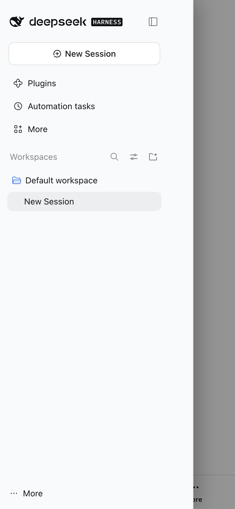
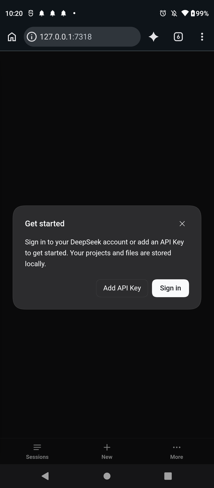
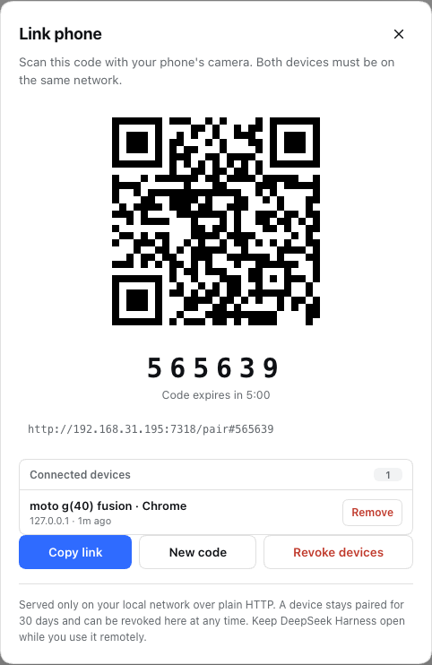

# DSH Pocket

Control the **running DeepSeek Harness Desktop app** from your phone on the same
network. A small, additive plugin starts a pairing-authenticated gateway in front
of the app's loopback web server; the phone loads the real DSH web UI, with a
mobile navigation bar, a session sheet, and the desktop sidebar as a drawer.



A physical **Moto G40 Fusion** (Android 12, Chrome 156) running the mobile
surface, and the desktop dialog listing it:





## What it gives you

- **QR pairing** from the desktop sidebar: scan once, stay paired for 30 days.
- **Paired devices at a glance**: the Link phone dialog lists every connected
  phone/tablet by model and browser, with last-seen time and a per-device
  **Remove** action.
- **The real app**, not a reimplementation: chat, streaming tool calls,
  approvals, questions, files, and sessions all behave as on the Mac.
- **A phone layout**: the 56px rail is replaced by a bottom bar, sessions open
  in a sheet, the full sidebar slides in from the left, and the composer respects
  safe areas and the on-screen keyboard.
- **A stable LAN endpoint**: the gateway listens on `0.0.0.0:7317` (with
  fallbacks) and proxies to the app's random loopback port, so the phone's URL
  survives desktop restarts.
- **Contained failure**: a busy port, missing TLS file, or unreachable upstream
  never stops the desktop app; the pairing dialog reports the problem.
- **Revocation**: remove one device without touching the others, or revoke all
  devices with one button.

## Quick start

**Inside DeepSeek Harness** — open **Plugins** in the left sidebar, click **Add
plugin**, and install from one of:

- **npm registry (recommended):** keep **Registry** on **Official npm registry**
  and enter `@awbuilds/dsh-pocket@0.0.4`
- the release tarball: `awbuilds-dsh-pocket-0.0.4.tgz`
- the local package directory: `packages/dsh-pocket`
- the GitHub repository: `https://github.com/awbuilds/dsh-pocket`

Enable the **`@awbuilds/dsh-pocket`** bundle. If **Link phone** does not appear
at the bottom of the sidebar, restart the app once.

DSH 0.2.1 reserves the Desktop profile for the app itself and rejects
`dsh plugin --profile desktop` from a terminal. The app's Plugins page is the
supported installer; a manifest-level fallback is
`node scripts/install-desktop.mjs --manual` after quitting the app.

**From source (development or a non-Desktop profile):**

```bash
git clone https://github.com/awbuilds/dsh-pocket.git
cd dsh-pocket
pnpm install
pnpm build
pnpm test
node scripts/dev.mjs
```

Reopen the app, click **Link phone** at the bottom of the sidebar, and scan the
QR code.

Full instructions: [docs/install.md](docs/install.md).
Security model: [docs/security.md](docs/security.md).
Architecture: [docs/architecture.md](docs/architecture.md).
Troubleshooting: [docs/troubleshooting.md](docs/troubleshooting.md).

## How it works

```
phone ──▶ gateway 0.0.0.0:7317 ──▶ DSH loopback server 127.0.0.1:<random>
          pairing cookie,            launch-token exchange,
          Origin checks,             signed browser cookie,
          TLS optional               /api RPC + remote.mux WS
```

The gateway keeps the DSH listener on loopback. It rewrites the proxied Host to
the loopback authority and strips browser provenance headers so the upstream
trust fence accepts the request, while the gateway's own signed cookie is the
LAN-facing credential. A document navigation without the upstream cookie is
bounced through the process launch token once; the same path heals an expired
upstream session.

The bundle is one profile row (`pocket`, package `@awbuilds/dsh-pocket`) that supplies both
halves: the host entry starts the gateway and the browser entry adds the mobile
surface through the app's own slot system (`shell.bottom`,
`sidebar.footer.action`).

Over plain HTTP, iOS *Add to Home Screen* works while Chrome's install prompt needs TLS. Set `tlsCertFile` / `tlsKeyFile` for an HTTPS gateway.

## Compatibility

Built against DSH **0.2.1-rc.5** (the runtime bundled in the Desktop app). The
bundle declares that peer; a runtime upgrade needs a rebuild against the new
version. See [docs/install.md](docs/install.md#update-after-a-dsh-upgrade).

## Status

- Automated: 64 unit/integration/component tests, typecheck, host + client builds.
- Verified against a real 0.2.1-rc.5 host: pairing, proxying, boot graph, plugin
  bundle, WebSocket mux, mobile bar, session sheet, drawer, desktop dialog, and
  revocation.
- Verified on a physical **Moto G40 Fusion** (Android 12, Chrome 156): QR
  pairing, app load, bottom bar, device list in the desktop dialog, and reopening
  after a host restart.
- Pending: the real-device checklist in
  [docs/mobile-checklist.md](docs/mobile-checklist.md) on iOS Safari and other
  Android browsers (keyboard behavior, safe areas, background reconnect).

## License

MIT. See [LICENSE](LICENSE).
